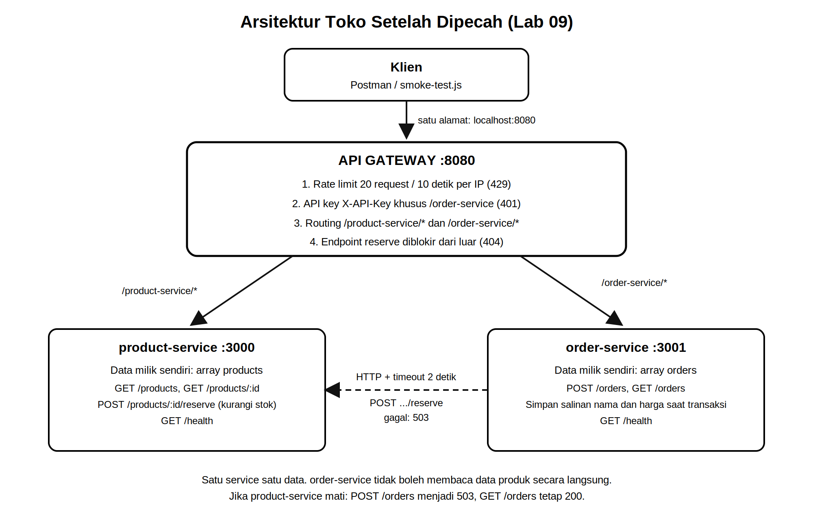
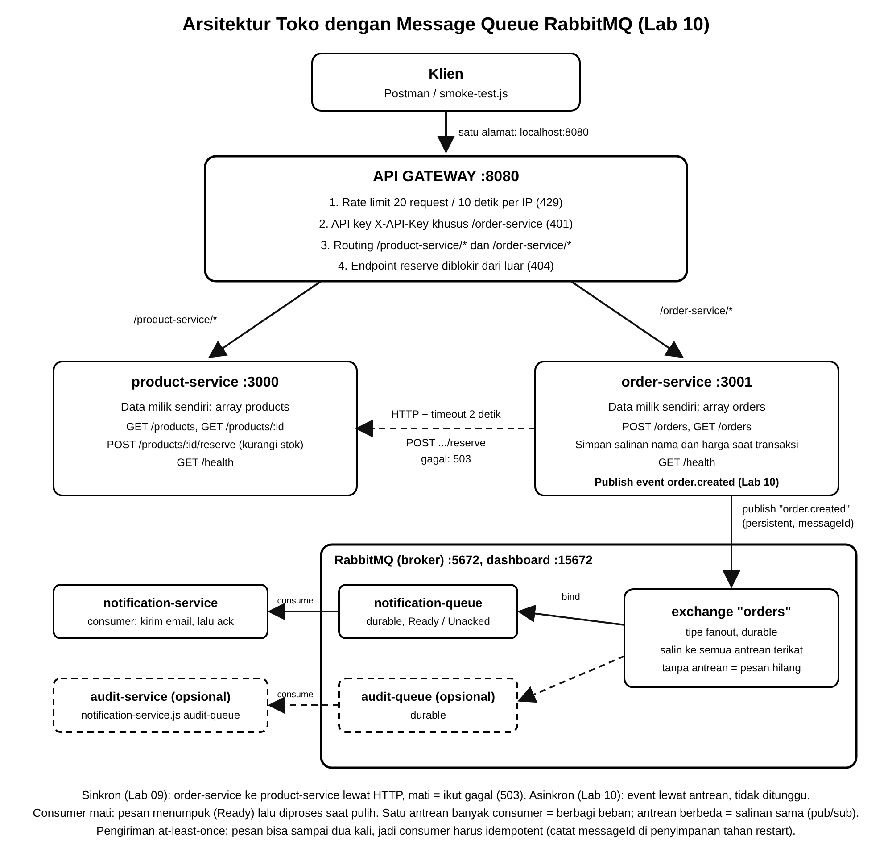

# Toko Microservices (Lab 09, Lab 10, dan Lab 11)

Memecah monolit toko sederhana (produk + pesanan) menjadi dua service dengan data masing-masing, dihubungkan lewat HTTP, dan dipasang di balik API gateway dari Lab 08.



Lab 10 menambahkan RabbitMQ, exchange `orders`, dan notification-service:



## Struktur

```
toko/
├── monolith/            # titik awal (satu proses, satu data), port 3000
├── product-service/     # pemilik data produk dan stok, port 3000
├── order-service/       # pemilik data pesanan, port 3001, memanggil product-service lewat HTTP (timeout 2 detik); Lab 10: menerbitkan event order.created
├── notification-service/ # Lab 10: consumer RabbitMQ (notification-queue / audit-queue / --crash)
├── gateway/             # API gateway dari Lab 08, port 8080 (/product-service/*, /order-service/*)
├── smoke-test.js        # uji end-to-end lewat gateway
├── kirim-order.js       # Lab 10: kirim N order beruntun lewat gateway
├── uji-kegagalan.js     # bantu bukti Langkah 06 (503 / 200 / 201)
├── postman/             # koleksi dan environment Postman
├── docs/                # diagram arsitektur, pemetaan proyek kelompok, refleksi
├── scripts/start-all.js
├── PANDUAN-LAB09.md     # Lab 09: langkah, pengujian, dan daftar screenshot
└── PANDUAN-LAB10.md     # Lab 10: langkah, pengujian, dan daftar screenshot
```

## Menjalankan

```bash
npm run install:all     # sekali saja
npm run start:all       # product-service :3000, order-service :3001, gateway :8080
node smoke-test.js      # di terminal lain
```

Atur ulang data dengan menjalankan ulang proses (data di memori). Jangan jalankan monolit bersamaan dengan product-service (port 3000 sama).

## Lab 10: komunikasi asinkron lewat RabbitMQ

```bash
docker run -d --name rabbit -p 5672:5672 -p 15672:15672 rabbitmq:3-management   # dashboard: http://localhost:15672 (guest/guest)
npm run install:all
cd notification-service && node notification-service.js      # consumer DULU (agar antrean terikat ke exchange)
npm run start:all                                            # product-service, order-service, gateway
node kirim-order.js 3                                        # kirim 3 order lewat gateway
```

Varian consumer: `node notification-service.js audit-queue` (pub/sub) dan `node notification-service.js --crash` (uji pengiriman ulang).
Alamat broker lewat environment variable `AMQP_URL` (default `amqp://localhost`); jangan menyimpan kredensial di repository.
Langkah lengkap, pengujian, dan daftar screenshot ada di `PANDUAN-LAB10.md`.

## Lab 11: dokumentasi API otomatis (OpenAPI/Swagger)

Tiap service menyajikan `/openapi.json` dan `/docs` sendiri (product-service :3000, order-service :3001), dan gateway menggabungkannya di **http://localhost:8080/docs** (spesifikasi mentah di `/openapi.json`). Salinan hasilnya ada di `openapi.json`. Untuk Try it out pada `/order-service`, klik **Authorize** dan isi `API_KEY` dari `gateway/.env`. Langkah, bukti, dan daftar screenshot ada di `PANDUAN-LAB11.md`.

## Endpoint lewat gateway (:8080)

- `GET /product-service/products`, `GET /product-service/products/:id` (publik)
- `POST /order-service/orders` dan `GET /order-service/orders` (wajib header `X-API-Key`)
- `POST /product-service/products/:id/reserve` hanya untuk order-service, diblokir dari luar (404)
- `GET /health` gateway, `GET /product-service/health`, `GET /order-service/health` (butuh key)

Kode status: `201` pesanan dibuat, `400` input salah, `401` API key salah atau tidak ada, `404` produk tidak ditemukan, `409` stok tidak cukup, `429` rate limit, `503` product-service tidak tersedia atau timeout 2 detik, `504` gateway tidak menjangkau service.

## Catatan desain

- Satu service satu data: order-service tidak punya array products, hanya bertanya lewat API `reserve`.
- Pesanan menyimpan salinan nama dan total saat transaksi agar riwayat tetap benar walau harga berubah.
- Data in-memory, sehingga hilang saat service restart.
- Lab 10: order-service menerbitkan event `order.created` (persistent, `messageId` = `order-<id>`) ke exchange fanout `orders`, lalu langsung membalas 201 tanpa menunggu consumer. Jika RabbitMQ mati, order tetap tersimpan tetapi event tidak terkirim (dibahas di refleksi Lab 10).
